  

  A team of formal verification engineers working on Web3 security. 
  We audit smart contracts and build the tooling behind those audits.

  <a href="https://www.dowsers.finance">Website</a> ·
  <a href="https://x.com/DowsersFinance">X</a> ·
  <a href="https://www.linkedin.com/company/dowsersfinance/">LinkedIn</a> ·
  <a href="mailto:hello@dowsers.finance">hello@dowsers.finance</a>

## Open source

| Project | Description |
| :-- | :-- |
| [dolmos](https://github.com/Dowsers/dolmos) | Symbolic testing for EVM smart contracts, driven by Foundry-style tests. Derived from [halmos](https://github.com/a16z/halmos). |
| [PaSTTeL](https://github.com/Dowsers/PaSTTeL) | Parallel SMT-based analysis of termination and non-termination for lasso-shaped programs. |
| [Scobelix](https://github.com/Dowsers/Scobelix) | EVM bytecode decompiler. Fork of [Panoramix](https://github.com/palkeo/panoramix). |

## Support

You can back our formal verification research on [Giveth](https://giveth.io/project/dowsers-formal-verification).
